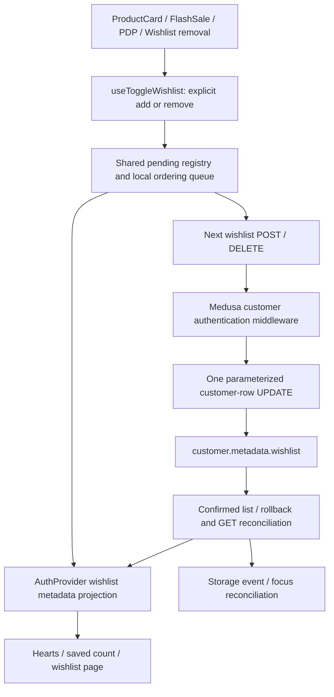
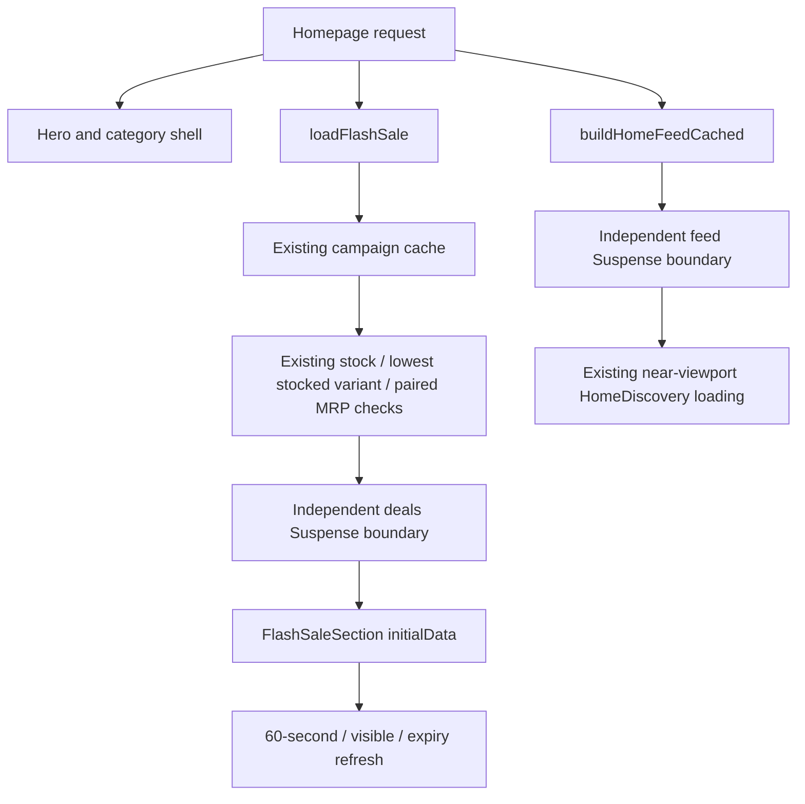
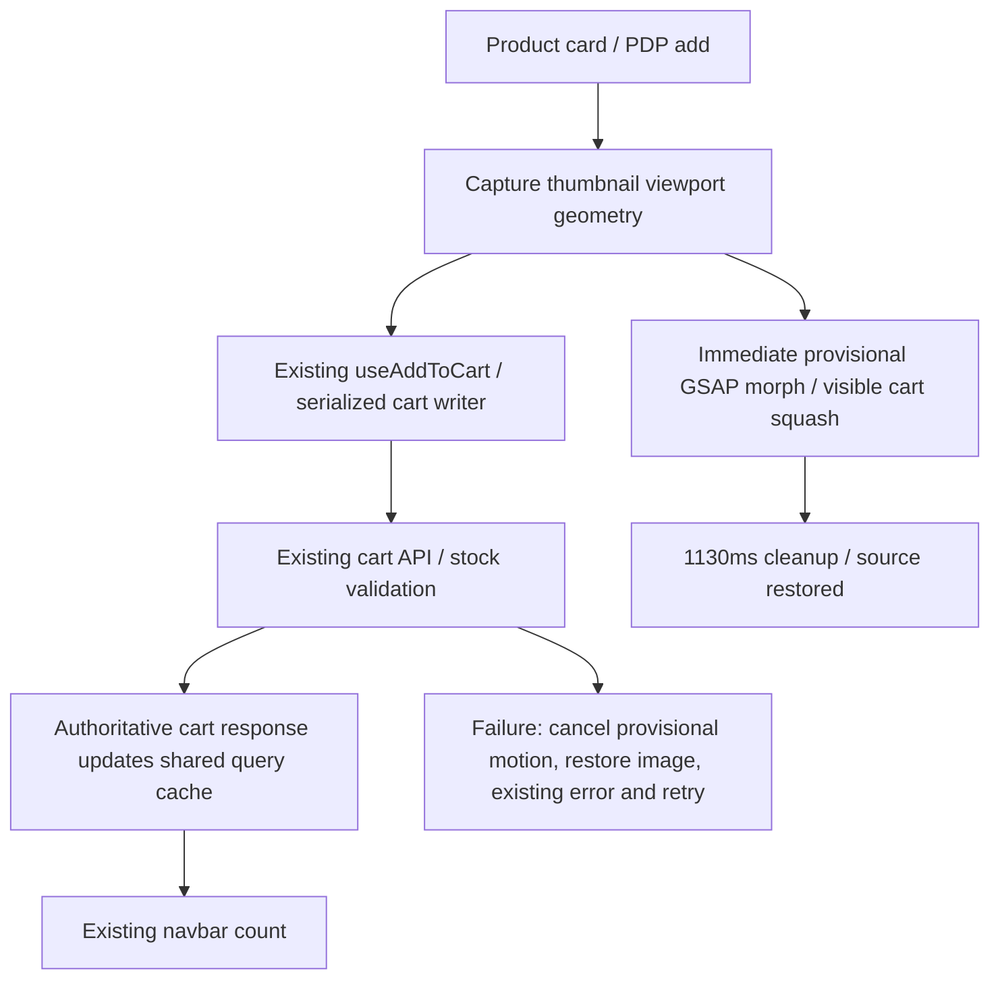

# Storefront interaction changes and QA — 3 November 2026

Work order: wishlist correctness, independent homepage loading, then cart motion. Integration target: `Krishnachandra_jha`. Feature branches: `feature/wishlist-consistency`, `feature/home-streaming`, `feature/cart-success-motion`. No remote push or production deployment performed in this task.

## Verified dependencies and root causes

Verified edges: `src/hooks/useWishlistMutations.ts:24` → `src/lib/wishlist-client.ts:4` → `src/app/api/medusa/wishlist/route.ts:110` → `my-medusa-store/src/api/store/customer-wishlist/route.ts:5` → `my-medusa-store/src/lib/customer-wishlist.ts:5`; `src/contexts/AuthProvider.tsx` owns the shared projection. Existing consumers still read customer metadata; no competing new store was introduced.

Before: each write read customer metadata and replaced the entire wishlist using that stale snapshot; overlapping requests could lose a saved item. Details were fetched sequentially. PDP and removal had separate mutation implementations. Captured customer objects could overwrite a newer login/profile.

Now: one database UPDATE computes add/remove from the row PostgreSQL updates, deduplicates IDs and preserves other metadata keys. Customer identity comes only from authenticated actor context. POST means add; DELETE means remove; both are repeat-safe. A local queue orders optimistic state and reconciliation, while database atomicity works independently of API instance count. Pending state is shared across mounted hooks. Failed/uncertain writes roll back and reconcile with GET, never automatically replay writes. Session guards reject old queued intents and old responses. Cross-tab storage/focus reads reconcile only wishlist IDs, without fetching every product. Product details run four at a time, preserve saved order/identity even if catalogue grouping chooses another seller, and include variant count so multi-variant wishlist items open option selection.

Alternative considered: a separate unique-key wishlist table. It provides stronger separation from generic customer-metadata writers but requires schema/backfill/read migration. Chosen row-atomic JSONB update preserves the existing data contract and requires no migration. A browser-only mutex was rejected because it cannot protect multiple API instances. Important boundary: another unrelated legacy client that deliberately overwrites the entire wishlist through generic customer metadata can still replace it; all storefront wishlist writers found in this repository now use the atomic endpoint.

Verified edges: `src/app/page.tsx:18`, `src/app/home/HomePage.tsx` (`HomeShell`, `HomeFeedSkeleton`, `sectionsOnly`), `src/lib/flash-sale-server.ts:24`, `src/lib/home-flash-sale.ts:19`, `src/components/flash-sale/FlashSaleSection.tsx`. Previously the route awaited the whole feed before rendering the hero, and deals started a browser fetch after mounting. The route now starts feed/deals together, streams their independent boundaries and renders the shell immediately. Successful initial deals do not trigger a duplicate mount fetch. Countdown starts with the serialized server snapshot, then recalculates from expiry. Skeletons reserve space; no active campaign can still collapse an unused deals slot, so zero production CLS is not promised. Overlapping stock validations coalesce without adding an inventory-result TTL. Existing raw campaign caching, expiry caps, sale variants/prices and below-fold discovery behavior remain intact.

Alternative considered: only start two client requests in parallel. This leaves hydration/network round trips on the critical path. Awaiting both on the server removes the browser request but still blocks the hero. Independent Suspense boundaries retain client interactions without that blocking dependency. No unrelated page rewrite or new runtime package was needed.

Verified edges: `ProductCardQuickActions.tsx` and PDP → `src/hooks/useCartMutations.ts:45` → `useCartWriter` / `src/lib/cart-client.ts` → shared cart query → `src/components/ui/CartSuccessMotion.tsx`. The mutation payload sent to the API is unchanged; geometry is UI-only. Motion starts immediately on intent while the existing API runs in parallel. The GSAP timeline is 1130ms: detach (120ms), diamond stretch (210ms), compression (130ms), flight (550ms), cart squash (120ms). Only server-confirmed persistence updates count and quantity; motion never fabricates an increment. Failure cancels the clone and restores source visibility, with the existing error toast and GET reconciliation. Missing image/target retains normal success feedback; reduced motion skips decoration. Geometry is responsive; a maximum of four flights can exist; animations/listeners/clones clean up. Failure leaves a usable Retry button. Quantity controls, seller selection, pricing, checkout and payment workers remain on their existing paths.

Updated user requirement: provisional motion before confirmation, with confirmed-only count. GSAP 3.15.0 drives a clipped diamond and GPU transforms inside a fixed, overflow-hidden portal. Source visibility is restored on completion, failure, preference changes and unmount. Cart impact ownership prevents overlapping flights from restoring another flight’s transform. Passive scroll/resize listeners dirty the destination measurement; layout is read again only when needed. Per-tab in-flight deduplication prevents rapid identical adds, while existing cross-tab Web Locks and cart writes are unchanged. This visual change does not change backend routes, checkout, inventory or payment-worker behavior. Real-device 60 FPS is a performance target, not a measured guarantee from desktop headless Chrome.

## Controlled before/after measurements

These are synthetic local fixtures, not live-site Web Vitals, real traffic capacity, or a full Next/Vercel end-to-end performance measurement. Each comparison uses three runs. The homepage benchmark runs the actual old/new Page composition with simplified visual components, a fixed 350ms feed and 150ms deals loader. It excludes real images, auth/header traffic, CDN/proxy behavior and real backend/database latency. Source baseline is commit `632b33e`.

- Fixture LCP (ms): median 408 → 48.
- Fixture CLS: median 0.196 → 0.
- Fixture TTFB (ms): median 365.3 → 4.
- Fixture deals visible (ms): median 540.7 → 157.6.
- Critical browser deals API requests: median 1 → 0.

Wishlist actual old/new GET route, 12 detail lookups with fixed 20ms fixture latency: median 370ms → 92ms; maximum concurrent detail functions 1 → 4. Timer scheduling contributes to absolute values. Saved order and all 12 products were asserted.

Raw runs: `docs/storefront-interactions-benchmark.json`, `docs/wishlist-read-benchmark.json`. Reproduce with `node scripts/home-streaming.benchmark.cjs` and `node scripts/wishlist-read.benchmark.cjs`. The former needs permission to use a temporary loopback fixture server, never production.

## Validation and its limits

Passed:
- Frontend full ESLint: zero errors, 22 pre-existing warnings. Targeted changed-file lint also passes.
- Frontend and Medusa TypeScript checks; local optimized production build.
- Unit/API regression suites: cart API, confirmation contracts, sale display/cache/enrichment, variant selection, product actions, shipping, search/read-readiness, wishlist queue/API/auth identity. The combined final runner has 56 entries, including the cart API script's nine internal scenarios.
- Cart real-React mocked-browser harness: 21 passing scenarios; updated cases include immediate parallel motion at 390/768/1280px, eight rapid identical intents issuing one POST, fast API confirmation during motion, scroll/resize destination refresh without overflow, mid-flight reduced-motion cancellation, failed and lost responses, counts, first-cart writes, cross-tab serialization, quantity/removal, reduced motion, missing image/target, animation disposal.
- Wishlist real-React mocked-browser harness: six cases covering optimistic/shared pending, repeat add, rollback, two tabs, old responses and same-tick account switch.
- Initial flash-sale server markup hydration: two viewport cases, no mismatch or duplicate initial fetch, visibility refresh and unmount cleanup.
- Checkout confirmation mocked-browser harness: 11 cases, including COD/online confirmation gates, cancelled/draft/session expiry, hidden tab, recovery and cart clearing.
- Isolated PostgreSQL engine: actual SQL accepted; legacy null metadata/list, duplicates, repeated add/remove, 30 queued operations, unrelated metadata/customer preservation and soft-deleted customer rejection. The embedded engine serializes queries, so this does not simulate multi-connection row-lock contention. It uses no DATABASE_URL and never touches the shared database. Test-only engine was installed in OS temp, not the project. Engine API documentation: https://pglite.dev/docs/api .
- Read-only local storefront inspection at desktop/mobile: real products, prices, countdown, shell and category links render, one main landmark, no horizontal overflow in the checked mobile viewport, mobile/desktop cart targets present. No live add, order or payment was created.

Not run / not claimed:
- No production load/stress test, live RUM LCP/CLS, or Vercel streaming/proxy timing measurement.
- No real concurrent multi-connection PostgreSQL contention/soak test. Row-level update design and parameterized SQL were inspected; embedded SQL and browser race tests passed.
- No new paid/live payment UAT or vendor mutation tests. Existing payment/checkout regression harnesses were used. No payment worker, commission, vendor flow, or admin auth implementation was changed.
- Existing Next image-wrapper warnings observed during local viewing were not expanded into an unrelated hero rewrite.

## Deployment order and manual QA

No database migration is required. Deploy/rebuild Medusa with the new authenticated `/store/customer-wishlist` route before deploying this frontend; otherwise wishlist mutations will receive an upstream 404. Existing saved lists need no backfill. No payment/commission worker restart is required for these changes.

After staging deployment: use a disposable customer to save/remove from listing, PDP and wishlist; check two same-origin tabs; interrupt a response and retry; switch account during a pending operation. Verify different sellers/size choices. Check mobile/desktop, keyboard focus, reduced motion, offline failure/retry and back navigation. Open a full cart and checkout and verify selected variant, price/discount, shipping boundary and confirmed count. Measure real LCP/CLS/TTFB and deals render timing on a cold mobile connection, and confirm proxy/CDN allows streaming. Run multi-connection wishlist and stock/read load tests on an isolated staging database before claiming heavy-traffic capacity. Do not run the repository's database-writing payment suites against the configured shared RDS database.

The pre-existing generated `my-medusa-store/.medusa/types/modules-bindings.d.ts` modification is excluded from all commits.

## Changed source and test files

- [docs/storefront-interactions-benchmark.json](C:/Users/jhakr/OneDrive/Desktop/oweg_ecom_module/oweg-ecommerce/docs/storefront-interactions-benchmark.json)
- [docs/wishlist-read-benchmark.json](C:/Users/jhakr/OneDrive/Desktop/oweg_ecom_module/oweg-ecommerce/docs/wishlist-read-benchmark.json)
- [my-medusa-store/src/api/middlewares.ts](C:/Users/jhakr/OneDrive/Desktop/oweg_ecom_module/oweg-ecommerce/my-medusa-store/src/api/middlewares.ts)
- [my-medusa-store/src/api/store/customer-wishlist/route.ts](C:/Users/jhakr/OneDrive/Desktop/oweg_ecom_module/oweg-ecommerce/my-medusa-store/src/api/store/customer-wishlist/route.ts)
- [my-medusa-store/src/lib/customer-wishlist.ts](C:/Users/jhakr/OneDrive/Desktop/oweg_ecom_module/oweg-ecommerce/my-medusa-store/src/lib/customer-wishlist.ts)
- [scripts/cart-consistency.browser.cjs](C:/Users/jhakr/OneDrive/Desktop/oweg_ecom_module/oweg-ecommerce/scripts/cart-consistency.browser.cjs)
- [scripts/flash-sale-display.test.cjs](C:/Users/jhakr/OneDrive/Desktop/oweg_ecom_module/oweg-ecommerce/scripts/flash-sale-display.test.cjs)
- [scripts/flash-sale-initial.browser.cjs](C:/Users/jhakr/OneDrive/Desktop/oweg_ecom_module/oweg-ecommerce/scripts/flash-sale-initial.browser.cjs)
- [scripts/home-streaming.benchmark.cjs](C:/Users/jhakr/OneDrive/Desktop/oweg_ecom_module/oweg-ecommerce/scripts/home-streaming.benchmark.cjs)
- [scripts/product-card-actions.test.cjs](C:/Users/jhakr/OneDrive/Desktop/oweg_ecom_module/oweg-ecommerce/scripts/product-card-actions.test.cjs)
- [scripts/wishlist-api.test.cjs](C:/Users/jhakr/OneDrive/Desktop/oweg_ecom_module/oweg-ecommerce/scripts/wishlist-api.test.cjs)
- [scripts/wishlist-consistency.browser.cjs](C:/Users/jhakr/OneDrive/Desktop/oweg_ecom_module/oweg-ecommerce/scripts/wishlist-consistency.browser.cjs)
- [scripts/wishlist-consistency.test.cjs](C:/Users/jhakr/OneDrive/Desktop/oweg_ecom_module/oweg-ecommerce/scripts/wishlist-consistency.test.cjs)
- [scripts/wishlist-postgres.test.cjs](C:/Users/jhakr/OneDrive/Desktop/oweg_ecom_module/oweg-ecommerce/scripts/wishlist-postgres.test.cjs)
- [scripts/wishlist-read.benchmark.cjs](C:/Users/jhakr/OneDrive/Desktop/oweg_ecom_module/oweg-ecommerce/scripts/wishlist-read.benchmark.cjs)
- [src/app/api/medusa/flash-sale/products/route.ts](C:/Users/jhakr/OneDrive/Desktop/oweg_ecom_module/oweg-ecommerce/src/app/api/medusa/flash-sale/products/route.ts)
- [src/app/api/medusa/wishlist/route.ts](C:/Users/jhakr/OneDrive/Desktop/oweg_ecom_module/oweg-ecommerce/src/app/api/medusa/wishlist/route.ts)
- [src/app/header/Header.tsx](C:/Users/jhakr/OneDrive/Desktop/oweg_ecom_module/oweg-ecommerce/src/app/header/Header.tsx)
- [src/app/home/HomePage.tsx](C:/Users/jhakr/OneDrive/Desktop/oweg_ecom_module/oweg-ecommerce/src/app/home/HomePage.tsx)
- [src/app/layout.tsx](C:/Users/jhakr/OneDrive/Desktop/oweg_ecom_module/oweg-ecommerce/src/app/layout.tsx)
- [src/app/page.tsx](C:/Users/jhakr/OneDrive/Desktop/oweg_ecom_module/oweg-ecommerce/src/app/page.tsx)
- [src/app/productDetail/productDetail.tsx](C:/Users/jhakr/OneDrive/Desktop/oweg_ecom_module/oweg-ecommerce/src/app/productDetail/productDetail.tsx)
- [src/components/account/WishlistContent.tsx](C:/Users/jhakr/OneDrive/Desktop/oweg_ecom_module/oweg-ecommerce/src/components/account/WishlistContent.tsx)
- [src/components/flash-sale/FlashSaleSection.tsx](C:/Users/jhakr/OneDrive/Desktop/oweg_ecom_module/oweg-ecommerce/src/components/flash-sale/FlashSaleSection.tsx)
- [src/components/mobile/MobileBottomNav.tsx](C:/Users/jhakr/OneDrive/Desktop/oweg_ecom_module/oweg-ecommerce/src/components/mobile/MobileBottomNav.tsx)
- [src/components/modules/ProductCardQuickActions.tsx](C:/Users/jhakr/OneDrive/Desktop/oweg_ecom_module/oweg-ecommerce/src/components/modules/ProductCardQuickActions.tsx)
- [src/components/ui/CartSuccessMotion.tsx](C:/Users/jhakr/OneDrive/Desktop/oweg_ecom_module/oweg-ecommerce/src/components/ui/CartSuccessMotion.tsx)
- [src/contexts/AuthProvider.tsx](C:/Users/jhakr/OneDrive/Desktop/oweg_ecom_module/oweg-ecommerce/src/contexts/AuthProvider.tsx)
- [src/hooks/useCartMutations.ts](C:/Users/jhakr/OneDrive/Desktop/oweg_ecom_module/oweg-ecommerce/src/hooks/useCartMutations.ts)
- [src/hooks/useWishlistMutations.ts](C:/Users/jhakr/OneDrive/Desktop/oweg_ecom_module/oweg-ecommerce/src/hooks/useWishlistMutations.ts)
- [src/lib/cart-flight.ts](C:/Users/jhakr/OneDrive/Desktop/oweg_ecom_module/oweg-ecommerce/src/lib/cart-flight.ts)
- [src/lib/flash-sale-server.ts](C:/Users/jhakr/OneDrive/Desktop/oweg_ecom_module/oweg-ecommerce/src/lib/flash-sale-server.ts)
- [src/lib/wishlist-client.ts](C:/Users/jhakr/OneDrive/Desktop/oweg_ecom_module/oweg-ecommerce/src/lib/wishlist-client.ts)

## Compact action feedback follow-up

Shopping feedback now replaces one shared message rather than stacking full product names. Cart success keeps View cart; login keeps Sign in. Wishlist save and quantity changes use a polite status region without a visual popup. Errors remain visible and replace stale actions. Wishlist removal offers one-shot Undo through the existing authenticated wishlist mutation; session changes/page exit dismiss the old action, and failed restores reconcile rather than claiming success.

The shared Sonner renderer uses neutral compact cards, an internal dismiss button, keyboard focus styles, reduced-motion CSS, safe-area offsets and 44px mobile action targets. Under 768px, the bar clears the existing 69px bottom navigation; desktop/tablet use the bottom corner. No backend or payment-worker change is required for this feedback follow-up.

Verification: `node scripts/notification-feedback.browser.cjs` passes eight scenarios using real Sonner, wishlist UI and wishlist mutations with all requests intercepted. Tested 320/390/768/1280px bounds, mobile touch targets/navigation clearance, no focus theft, View cart/Sign in, silent status announcements, replacement, reduced motion, successful Undo, account switch and failed Undo. Existing cart (21 scenarios), wishlist (6 scenarios), and related cart/variant/wishlist regression suite (17 runner entries) pass. No live customer data was changed.

Cart motion timing follow-up: travel increased from 260ms to 550ms with a gentler ease, and opacity stays solid until the final 140ms. Total duration is now 1130ms, following the request to see the product travel clearly. API requests and server-confirmed counts remain independent of this decorative timing.
